<div align="center">

  

  # ⚡ Awesome Request Management

  <p align="center">
    <strong>A curated directory of enterprise Service Request Portals, Self-Service Catalogs, Approval Hierarchies, ITSM/ESM Platforms &amp; Fulfillment Automation Workflows.</strong>
  </p>

  <p align="center">
    <a href="https://github.com/ishandutta2007/Awesome-Awesome-Awesome"></a><a href="https://discord.gg/jc4xtF58Ve"></a>
    <a href="https://github.com/ishandutta2007/Awesome-Request-Management/stargazers"></a>
    <a href="https://github.com/ishandutta2007/Awesome-Request-Management/network/members"></a>
    <a href="https://github.com/ishandutta2007/Awesome-Request-Management/blob/main/LICENSE"></a>
    <a href="https://github.com/ishandutta2007/Awesome-Request-Management/pulls"></a>
    <a href="https://github.com/ishandutta2007"></a>
  </p>

</div>

---

## 📖 Overview &amp; Architecture Landscape

In modern digital enterprises, an **IT Service Request Management** platform (and broader **Enterprise Service Management / ESM** ecosystem) functions as the unified operational storefront for organizational capabilities. It converts chaotic email chains, disconnected instant messages, and informal shoulder-taps into structured, auditable, and SLA-governed service requests—spanning hardware procurement, cloud application provisioning, employee onboarding, access elevation, and facilities services.

A mature Request Management architecture integrates five mission-critical layers:
1. 🛒 **Consumerized Self-Service Storefront**: Intuitive, taxonomy-driven portals and GenAI conversational assistants empowering employees to locate and submit requests effortlessly.
2. 📝 **Dynamic Form &amp; Validation Engine**: Conditional fields, asset lookups, and dependent dropdowns capturing complete fulfillment context upfront.
3. 🔀 **Multi-Stage Approval Hierarchies**: Rule-based manager approvals, financial threshold reviews, and security sign-offs executed via email, mobile, or collaboration hubs (Slack/Teams).
4. ⚙️ **Fulfillment Orchestration &amp; Automation**: Zero-touch API connectors, webhook dispatchers, and BPMN/RPA pipelines automating user provisioning (Active Directory/Okta/SaaS), device allocation, and software deployments.
5. ⏱️ **SLA &amp; Lifecycle Governance**: Granular tracking of response/fulfillment Service Level Agreements, operational KPIs, and real-time status transparency.

---

## 📑 Table of Contents

- [🌐 Sector Overview &amp; Market Dynamics](#-sector-overview--market-dynamics)
- [☁️ SaaS &amp; Hosted Request Management Platforms](#️-saas--hosted-request-management-platforms)
- [🔓 Open-Source GitHub Projects (Ranked by Stars)](#-open-source-github-projects-ranked-by-stars)
- [📊 Architectural Comparison Matrix](#-architectural-comparison-matrix)
- [🤝 How to Contribute](#-how-to-contribute)
- [📈 Star History](#-star-history)
- [💖 Support &amp; Sponsorship](#-support--sponsorship)
- [⚖️ Disclaimer](#️-disclaimer)

---

## 🌐 Sector Overview &amp; Market Dynamics

The global **ITSM and Request Management market** was valued at approximately **$14.2 Billion in 2024** and is projected to expand to **$34.5 Billion by 2030**, exhibiting a compound annual growth rate (**CAGR of ~14.2%**). The sector exhibits **moderate market concentration** at the Fortune 500 enterprise tier—dominated by heavyweight platforms like ServiceNow and Atlassian—while displaying **dynamic fragmentation** across the mid-market and SME segments, where specialized SaaS contenders (Freshservice, HaloITSM) and sovereign open-source solutions (GLPI, Zammad) compete intensely on flexibility, deployment sovereignty, and per-seat cost efficiency.

---

## ☁️ SaaS &amp; Hosted Request Management Platforms

The table below catalogs top commercial platforms, sorted by **Company Size (Valuation / Annual Revenue)** in descending order:

| 🏢 Platform / Vendor | 📊 Company Size (Valuation / Revenue) | 💰 Starting Price (Specific Tier) | 🆓 Free Tier / Free Trial Limits | 🚀 Core Request Management Capabilities |
| :--- | :--- | :--- | :--- | :--- |
| **[ServiceNow Request Management](https://www.servicenow.com/)** | **~$205B Market Cap**<br>*(~$10.9B Annual Rev - NYSE: NOW)* | **$70 – $100 / fulfiller / mo**<br>*(ITSM Foundation tier)* | **Free Personal Developer Instance (PDI)**<br>Full platform capabilities, active indefinitely with regular usage | Enterprise Service Catalog, RITM-level multi-stage approval workflows, Flow Designer fulfillment orchestration, AI deflection, deep CMDB asset linking |
| **[Jira Service Management](https://www.atlassian.com/software/jira/service-management)** | **~$50B Market Cap**<br>*(~$4.4B Annual Rev - NASDAQ: TEAM)* | **$20 / agent / mo**<br>*(Standard monthly; $17.65/mo billed annually)* | **Free forever for up to 3 agents**<br>Includes 2 GB file storage, unlimited customer requesters, community support | Request types mapped to underlying issue schemes, request group portal taxonomy, Slack/Teams conversational ticketing, Atlassian Assets (Insight) |
| **[ManageEngine ServiceDesk Plus](https://www.manageengine.com/products/service-desk/)** | **~$10B+ Valuation**<br>*(~$1.2B Annual Rev - Zoho Corp)* | **$13 / technician / mo**<br>*(Standard Cloud) or $495/yr (Professional on-prem)* | **Free forever for up to 5 technicians**<br>Standard Edition with unlimited end-user requesters and community support | Dynamic request catalog templates, multi-stage technician approval chains, SLA escalation triggers, automated business assignment rules, asset CMDB |
| **[BMC Helix ITSM](https://www.bmc.com/)** | **~$8.5B Enterprise Valuation**<br>*(~$2.3B Annual Rev - KKR)* | **~$115 – $136 / named user / mo**<br>*(Entry Service Desk suite)* | **30-day sandbox trial**<br>Full access guided sandbox; custom 30–60 day Proof of Concept (PoC) environment | Service Request Definitions (SRDs), BMC Atrium CMDB integration, multi-level business approval trees, AI-driven cognitive self-service workplace |
| **[Freshservice](https://www.freshworks.com/freshservice/)** | **~$4.5B Market Cap**<br>*(~$720M Annual Rev - NASDAQ: FRSH)* | **$19 / agent / mo**<br>*(Starter tier billed annually, or $29/mo monthly)* | **14-day free trial**<br>Full platform feature access, unlimited agents &amp; requesters, no credit card required | Consumerized self-service catalog, 3-tier dynamic conditional form fields, multi-department request workflows, Freddy AI ticket deflection |
| **[Ivanti Neurons for ITSM](https://www.ivanti.com/)** | **~$4.0B Enterprise Valuation**<br>*(~$1.5B Annual Rev)* | **~$95 / analyst / mo**<br>*(Entry named license; min system spend ~$20k/yr)* | **30-day Proof of Concept (PoC)**<br>Tailored sandbox environment via sales engineering (no self-serve free plan) | Self-Service Portal V3, external request offerings, dynamic form behavior rules, automated cancellation workflows, Neurons automated discovery |
| **[SolarWinds Service Desk](https://www.solarwinds.com/service-desk)** | **~$2.3B Market Cap**<br>*(~$785M Annual Rev - NYSE: SWI)* | **$39 / technician / mo**<br>*(Essentials tier, billed annually)* | **30-day free trial**<br>Full Premier-tier features access, unlimited requestors, no credit card required | Service catalog designer, dynamic conditional decision trees, pause-aware SLA target timers, automated incident/request triage queues |
| **[TOPdesk](https://www.topdesk.com/)** | **~$650M Valuation**<br>*(~$115M / €105M ARR)* | **$76 / agent / mo**<br>*(€61–$76/mo Essential plan)* | **30-day free trial**<br>Full access to operator dashboard and requester self-service portal, no credit card required | Self-service portal with visual form designer, AI category suggestions, real-time requester status tracking, shared service center workflows |
| **[HaloITSM](https://www.haloitsm.com/)** | **~$280M Valuation**<br>*(~$38M Annual Rev)* | **$99 / agent / mo**<br>*(All-inclusive package billed annually for 10 agents)* | **30-day free trial**<br>Full platform access to all modules, unlimited self-service portal users, no credit card required | All-inclusive pricing without gated modules, pre-configured request types with default SLAs/mailboxes, smart request-to-problem escalation |
| **[SysAid](https://www.sysaid.com/)** | **~$220M Valuation**<br>*(~$42M Annual Rev)* | **$89 / agent / mo**<br>*(Professional tier with built-in AI features)* | **30-day free trial**<br>Full feature set access including AI Copilot chatbot, no credit card required | AI Copilot conversational request submission, dynamic category-driven forms, automated approval hierarchies, visual ticket journey tracker |

---

## 🔓 Open-Source GitHub Projects (Ranked by Stars)

Self-hosted open-source stacks enable organizations to retain total data sovereignty, audit compliance, and eliminate per-agent recurring licensing fees. Repositories are ranked below in **descending order of GitHub star count**:

- **[Chatwoot](https://github.com/chatwoot/chatwoot)** <a href="https://github.com/chatwoot/chatwoot/stargazers"></a>  
  💬 Open-source customer engagement platform and ticketing system providing omni-channel customer request fulfillment, automation workflows, live chat widgets, and conversational bot integration. (Ruby/Vue.js · MIT)

- **[GLPI](https://github.com/glpi-project/glpi)** <a href="https://github.com/glpi-project/glpi/stargazers"></a>  
  🏢 Comprehensive open-source IT service management suite featuring modular service catalog form creation, SLA deadline management, financial request tracking, and deep hardware/software inventory CMDB linkage. (PHP · GPL-3.0)

- **[Zammad](https://github.com/zammad/zammad)** <a href="https://github.com/zammad/zammad/stargazers"></a>  
  ⚡ Fast, modern web-based helpdesk and service ticket system with real-time multi-channel request management, customizable form fields, auto-assignment rules, and customer self-service portal. (Ruby · AGPL-3.0)

- **[FreeScout](https://github.com/freescout-help-desk/freescout)** <a href="https://github.com/freescout-help-desk/freescout/stargazers"></a>  
  📬 Lightweight, self-hosted helpdesk and shared inbox with module marketplace for custom request fields, satisfaction ratings, workflows, auto-replies, and internal request routing. (PHP/Laravel · AGPL-3.0)

- **[osTicket](https://github.com/osTicket/osTicket)** <a href="https://github.com/osTicket/osTicket/stargazers"></a>  
  🎟️ Widely deployed open-source support ticketing software featuring configurable help topics, custom form fields functioning as request catalogs, auto-routing rules, and SLA tracking timers. (PHP · GPL-2.0)

- **[Frappe Helpdesk](https://github.com/frappe/helpdesk)** <a href="https://github.com/frappe/helpdesk/stargazers"></a>  
  🐍 Modern, 100% open-source ticket management platform built on Python and Frappe Framework, supporting customized request doctypes, dynamic form logic, multi-stage SLA policies, and Docker deployment. (Python/Vue · GPL-3.0)

- **[Helpy](https://github.com/helpyio/helpy)** <a href="https://github.com/helpyio/helpy/stargazers"></a>  
  📱 Mobile-first open-source customer support platform featuring multichannel ticket management, self-service knowledge base, and community forums for request submission and deflection. (Ruby on Rails · MIT)

- **[Trudesk](https://github.com/polonel/trudesk)** <a href="https://github.com/polonel/trudesk/stargazers"></a>  
  🌐 Open-source helpdesk and ticket tracking solution built on Node.js and MongoDB, offering real-time messaging, role-based access control, custom dynamic fields, and reporting dashboards. (Node.js · Apache-2.0)

- **[Faveo Helpdesk](https://github.com/faveosuite/faveo-helpdesk)** <a href="https://github.com/faveosuite/faveo-helpdesk/stargazers"></a>  
  💡 Responsive open-source help desk and customer request tracking software with SLA rule management, workflow triggers, ticket forms, and priority escalation queues. (PHP/Laravel · GPL-3.0)

- **[iTop](https://github.com/Combodo/iTop)** <a href="https://github.com/Combodo/iTop/stargazers"></a>  
  🧩 Complete open-source ITIL-aligned ITSM and CMDB web platform with comprehensive service catalog definitions, hierarchical approval workflows, impact-aware fulfillment, and REST API automation. (PHP · AGPL-3.0)

- **[Request Tracker (RT)](https://github.com/bestpractical/rt)** <a href="https://github.com/bestpractical/rt/stargazers"></a>  
  🛡️ Industrial-grade, battle-tested open-source issue and service request tracking system trusted worldwide for enterprise request fulfillment, fine-grained permission control, and scrip automation workflows. (Perl · GPL-2.0)

- **[OpenSupports](https://github.com/opensupports/opensupports)** <a href="https://github.com/opensupports/opensupports/stargazers"></a>  
  🎨 Open-source ticket management system built with PHP and ReactJS, providing clean self-service ticket submission, custom staff departments, article search, and responsive mobile-ready interface. (PHP/React · GPL-3.0)

- **[Znuny](https://github.com/znuny/Znuny)** <a href="https://github.com/znuny/Znuny/stargazers"></a>  
  🔄 Open-source ITSM and helpdesk platform (OTRS fork) with structured customer self-service portal, service catalog options, multi-calendar SLA escalation handling, and granular audit logs. (Perl · GPL-3.0)

- **[heidsoft ITSM](https://github.com/heidsoft/itsm)** <a href="https://github.com/heidsoft/itsm/stargazers"></a>  
  🤖 AI-native open-source ITSM platform with embedded LLM request triage, automated summarization, BPMN orchestration engine, CMDB, and cloud-native Docker/K8s deployment. (Go/Vue · Apache-2.0)

---

## 📊 Architectural Comparison Matrix

| 🛠️ Solution | 📜 License | 💻 Core Stack | 📋 Request Catalog | 🔀 Multi-Tier Approvals | ⏱️ SLA Engine | 📦 CMDB Linkage | 🎯 Best-Fit Use Case |
| :--- | :--- | :--- | :--- | :--- | :--- | :--- | :--- |
| **GLPI** | GPL-3.0 | PHP / MySQL | ✅ Form Creator | ✅ Multi-Level | ✅ Native Timers | ✅ Integrated | Hardware-intensive enterprise IT &amp; asset inventory |
| **Zammad** | AGPL-3.0 | Ruby / PostgreSQL | ✅ Custom Fields | ⚠️ Basic Workflow | ✅ Visual Timers | ⚠️ API Dependent | Modern, fast employee and customer request desks |
| **Chatwoot** | MIT | Ruby / Vue.js | ⚠️ Omni-Channel | ⚠️ Automation Rules | ✅ Business Hours | ❌ No | Customer-facing omnichannel support &amp; conversational bots |
| **FreeScout** | AGPL-3.0 | PHP / Laravel | ✅ Module Fields | ⚠️ Plugin-Based | ✅ Custom SLAs | ❌ No | Lightweight shared inbox &amp; simple internal requests |
| **osTicket** | GPL-2.0 | PHP / MySQL | ✅ Help Topics | ⚠️ Departmental | ✅ Strict Deadlines | ❌ No | Traditional, straightforward web/email ticket intake |
| **Frappe Helpdesk** | GPL-3.0 | Python / Vue | ✅ DocType Forms | ✅ Workflow Engine | ✅ Escalation Rules | ⚠️ via ERPNext | Teams leveraging Python, ERPNext, and Docker |
| **iTop** | AGPL-3.0 | PHP / MariaDB | ✅ XML Catalogs | ✅ Contract-Based | ✅ Contractual SLAs | ✅ Full Dependency | Strict ITIL compliance with deep CMDB topology mapping |
| **Request Tracker** | GPL-2.0 | Perl / MariaDB | ✅ Custom CFs | ✅ Scrip Chains | ✅ Strict Deadlines | ⚠️ via Extensions | High-throughput engineering, ISP, and university desks |

---

## 🤝 How to Contribute

Contributions, project recommendations, and documentation enhancements are highly encouraged!

1. 🍴 **Fork the repository** to your personal personal GitHub account.
2. 🌿 **Create a descriptive feature branch**:
   ```bash
   git checkout -b feat/add-request-platform
   ```
3. ✍️ **Commit your modifications** ensuring clear, factual data, exact pricing/trial information, official links, and clean Markdown table formatting.
4. 🚀 **Push the branch** and **open a Pull Request** with an informative summary of your changes.

---

## 📈 Star History

[](https://star-history.dera.page/#ishandutta2007/Awesome-Request-Management&type=date&legend=top-left)

---

## 💖 Support &amp; Sponsorship

If you find this curated Request Management ecosystem directory helpful for your team, organization, or workflows:

- ⭐ **Star this repository** on GitHub to amplify its visibility!
- 🍴 **Fork the repository** to save a personal copy and customize for your organization.
- 📢 **Share with fellow IT leaders**, DevOps teams, sysadmins, and service managers.
- ☕ **Support continuous maintenance &amp; research** via the GitHub Sponsors dashboard:

<p align="center">
  <a href="https://github.com/sponsors/ishandutta2007">
    
  </a>
</p>

---

## ⚖️ Disclaimer

- This repository is a **community-curated directory** created solely for informational, architectural, and educational purposes. Mention of specific vendors, open-source projects, or commercial SaaS products does not constitute an official endorsement.
- Pricing, packaging, and free trial terms are subject to change by respective vendors. Consult official vendor websites for real-time contractual quotes and Service Level Agreements.
- Self-hosted open-source solutions require rigorous security hardening, regular backup procedures, and role-based access management before deployment in production environments.
- Verify software license terms (AGPL-3.0, GPL-3.0, Apache-2.0, MIT) prior to commercial redistribution or proprietary internal modifications.

---

<p align="center">
  <strong>Crafted with ❤️ for IT service managers, help desk administrators, systems architects, and engineering leaders shaping seamless request fulfillment experiences.</strong>
</p>
